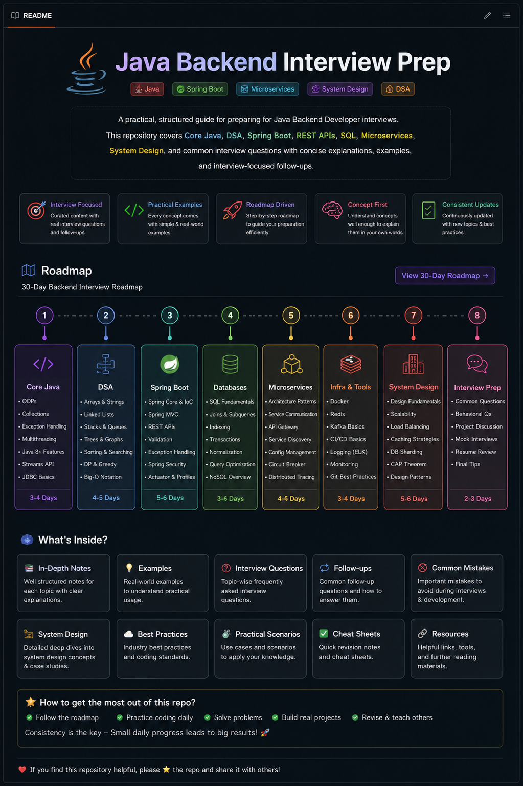

# ☕ Java Backend Interview Prep

  A practical, structured guide for preparing for Java Backend Developer interviews.

## Start here

Use the [30-day roadmap](ROADMAP.md) to plan a study sequence, then follow the links below to the topic guides. The roadmap is a flexible checklist: extend it to fit your schedule and revisit any topic that needs more practice.

## Study guides

| Area | Topics |
| --- | --- |
| [Core Java](01-core-java/java-basics.md) | Object-oriented programming, strings, collections, exceptions, generics, streams, concurrency, and the JVM |
| [Data structures and algorithms](02-dsa/01-arrays.md) | Arrays, hashing, common patterns, trees, graphs, and dynamic programming |
| [Spring Boot](03-spring-boot/01-spring-boot-fundamentals.md) | Spring fundamentals, dependency injection, REST, persistence, security, testing, and production readiness |
| [REST APIs](04-rest-api/01-rest-api-fundamentals.md) | HTTP, API design, validation, security, pagination, testing, and documentation |
| [SQL](05-sql/01-sql-fundamentals-and-database-basics.md) | Queries, joins, schema design, transactions, indexes, and performance |
| [Microservices](06-microservices/01-microservices-fundamentals.md) | Service boundaries, communication, resilience, messaging, and operations |
| [Hibernate and JPA](07-hibernate/01-hibernate-jpa-fundamentals.md) | Entity mapping, fetching, transactions, and persistence performance |
| [Redis](08-Redis/01-redis-fundamentals.md) | Data structures, caching, distributed coordination, and operations |
| [Docker](09-Docker/01-docker-fundamentals.md) | Images, containers, networking, Compose, and deployment practices |
| [System design](10-system-design/01-system-design-fundamentals.md) | Requirements, scalability, data, reliability, and case studies |

## A practical study loop

For each topic:

1. Read the guide and note the concepts you cannot yet explain.
2. Write or run a small example, or solve a related coding problem.
3. Explain the trade-offs and likely follow-up questions aloud.
4. Mark the roadmap item complete only after you can explain it without relying on the notes.

The guides are organized by subject, so you can also use the index above to study a particular interview gap without following the 30-day sequence.
